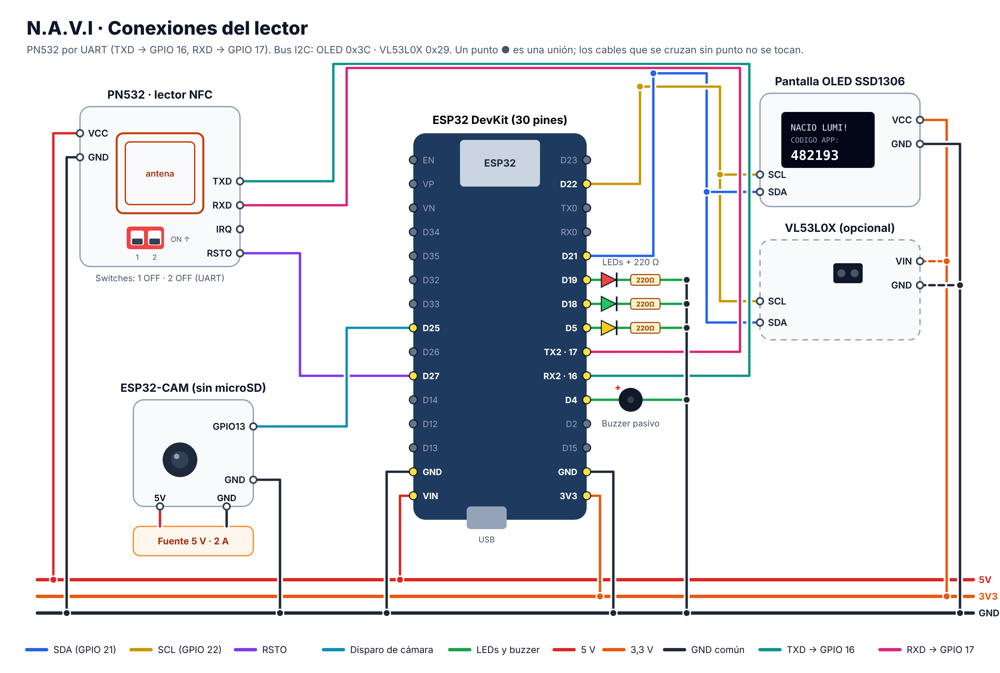

# Probar N.A.V.I con los módulos reales

Guía corta para pasar de la app al lector de verdad: ESP32 + PN532 + pantalla OLED + LEDs + buzzer, y la cámara ESP32-CAM si la tienes.

La IP de tu PC y la **clave de terminal** (la que firma la comunicación entre el lector y el servidor) se ponen solas en el firmware. Solo tienes que escribir el nombre y la clave de tu WiFi.



## 1. Conecta los módulos

Con el ESP32 **desconectado** del USB:

| Módulo | Pin del módulo | Pin del ESP32 |
| --- | --- | --- |
| PN532 (switches: 1 en ON, 2 en OFF) | VCC · GND · SDA · SCL · IRQ · RSTO | 5V · GND · GPIO 21 · GPIO 22 · GPIO 26 · GPIO 27 |
| OLED 0,96" | VCC · GND · SDA · SCL | 3.3V · GND · GPIO 21 · GPIO 22 |
| LED verde | + (pata larga) | GPIO 18, con resistencia de 220 Ω a GND |
| LED amarillo | + | GPIO 5, con resistencia de 220 Ω a GND |
| LED rojo | + | GPIO 19, con resistencia de 220 Ω a GND |
| Buzzer | + · − | GPIO 4 · GND |
| ESP32-CAM (opcional) | GPIO 13 · GND | GPIO 25 · GND (tierra común obligatoria) |
| VL53L0X (opcional) | VIN · GND · SDA · SCL | 3.3V · GND · GPIO 21 · GPIO 22 |

La explicación completa, con fotos de qué revisar, está en [`docs/CONEXIONES_Y_ESQUEMATICO.md`](docs/CONEXIONES_Y_ESQUEMATICO.md).

## 2. Enciende el servidor

1. La PC y el ESP32 deben estar en el **mismo WiFi**. En el colegio, si los equipos no se ven entre sí, usa el hotspot de tu celular para los dos.
2. Doble clic en **`INICIAR_NAVI.bat`** (o `INICIAR_NAVI_DEMO.bat` para probar con los estudiantes de ejemplo).
3. En la ventana negra debe salir:

   ```
   Firmware listo: la IP 192.168.x.x y la clave ya están en firmware/navi_esp32_pn532/servidor.h ...
   ```

   Ese archivo `servidor.h` tiene la IP de tu PC, el puerto y la clave de terminal. No lo subas a GitHub: ya está excluido.

Si la IP de tu PC cambia (otro WiFi, otro día), no hace falta volver a programar: el lector y la cámara buscan el servidor solos en la red.

## 3. Prepara Arduino IDE (una sola vez)

1. **Archivo → Preferencias → URLs adicionales de gestor de placas:** pega
   `https://espressif.github.io/arduino-esp32/package_esp32_index.json`
2. **Herramientas → Placa → Gestor de placas:** instala **esp32 de Espressif** (versión 3.x).
3. **Herramientas → Administrar bibliotecas:** instala
   - Adafruit PN532
   - Adafruit SSD1306
   - Adafruit GFX Library
   - ArduinoJson
   - Adafruit VL53L0X (solo si usas el sensor)

## 4. Sube el programa del lector

1. Abre `firmware/navi_esp32_pn532/navi_esp32_pn532.ino`.
2. En la pestaña **mis_datos.h** (la crea sola `INICIAR_NAVI.bat`) cambia estas dos líneas:

   ```
   #define WIFI_SSID "NOMBRE_DE_TU_WIFI"
   #define WIFI_PASS "CLAVE_DE_TU_WIFI"
   ```

   `mis_datos.h` y `servidor.h` no se suben a GitHub: la clave de tu WiFi se queda solo en tu PC.

3. Placa: **ESP32 Dev Module**. Puerto: el COM que aparece al conectar el ESP32.
   En **Herramientas → Partition Scheme** elige **Huge APP (3MB No OTA/1MB SPIFFS)**. Con la opción por defecto el programa no cabe ("Sketch too big").
4. Clic en **Subir**. Si se queda en "Connecting…", mantén presionado el botón **BOOT** del ESP32 hasta que empiece a subir.
5. Abre el **Monitor serie** a **115200**. Debe decir `PN532 v1.6 listo` y luego la IP del ESP32.

## 5. La cámara ESP32-CAM (opcional)

La cámara toma una foto en el momento en que el estudiante acerca la tarjeta. Si la foto sale negra (cámara tapada) o hay algo raro, el registro queda en **Revisión** con la foto para que el docente compare.

**Conexiones**

La cámara **no necesita cable hacia el lector**: en cada toque el servidor le pide la foto por WiFi. Solo necesita corriente:

| Opción | Cómo |
| --- | --- |
| Con la placa ESP32-CAM-MB | Encájala y conecta su USB a un cargador de celular de 5 V |
| Sin la placa | 5V y GND de la cámara a una fuente de 5 V y 2 A |

El cable **GPIO 25 del lector → GPIO 13 de la cámara** (con GND común) es opcional: hace la foto unos milisegundos más rápido. Si lo usas, no pongas tarjeta microSD en la cámara.

**Subir el programa**

1. Abre `firmware/navi_esp32_cam/navi_esp32_cam.ino` y escribe tu WiFi en su `mis_datos.h` (la IP y la clave ya están en `servidor.h`).
2. Placa: **AI Thinker ESP32-CAM** (grupo *esp32*). Revisa que **PSRAM** esté en *Enabled* y la partición en *Huge APP*.
3. Para subir:
   - **Con la placa base ESP32-CAM-MB** (la que trae USB): conéctala y sube. Si se queda en "Connecting…", mantén presionado **IO0** y toca **RST**.
   - **Con un adaptador FTDI**: une **GPIO 0 con GND**, presiona **RST**, sube, quita el puente y presiona **RST** otra vez.
4. En el Monitor serie (115200) debe salir `Camara lista (con PSRAM, fotos VGA)`, `WiFi OK`, `Servidor conectado` y `Conexion de espera con el servidor lista`.
5. Escribe **f** y presiona Enter: toma una foto de prueba y dice `Foto 18000 bytes -> HTTP 200`.
6. En la app, **Lector → Hardware conectado** muestra la cámara **En línea**. Al acercar una tarjeta, la foto aparece en el registro del estudiante.

## 6. Prueba en la app

| Prueba | Qué debe pasar |
| --- | --- |
| Abre **Lector → Hardware conectado** | `ESP32-AULA-1` aparece **En línea** |
| Acerca una tarjeta que no está registrada | El lector suena con LED rojo y dice `TARJETA NO REGISTRADA`. En la app sale un aviso con el botón **Registrar**, que ya trae el número de la tarjeta |
| Registra al estudiante y vuelve a acercar la tarjeta | Nace su mascota en la pantalla y aparece un código de 6 números para su cuenta |
| En un celular: **Estudiante → Usar el lector del aula** y escribe el código | Se crea su PIN y ve su mascota |
| En la ficha del estudiante: **Tarjeta y acceso → Grabar con el lector del aula** | Deja la tarjeta quieta hasta oír dos bips: queda grabada con su credencial firmada |
| Acerca la misma tarjeta otra vez | Dice `YA MARCO` con la hora del primer toque |

## 7. En cualquier red: WiFi del colegio o hotspot del celular

N.A.V.I funciona **sin internet**: la PC, el lector, la cámara y los celulares solo necesitan estar en la misma red. El internet solo se usa para enviar correos.

**Guarda hasta tres redes** en `mis_datos.h` (por ejemplo la de tu casa, la del colegio y el hotspot de tu celular). El lector y la cámara se conectan a la que encuentren con mejor señal:

```
#define WIFI_SSID_2 "HOTSPOT_DANIEL"
#define WIFI_PASS_2 "CLAVE_DEL_HOTSPOT"
```

**Ya no hace falta volver a programar al cambiar de red.** Si la PC tiene otra IP, el lector y la cámara buscan el servidor solos en la red (tarda unos segundos), comprueban que tenga la misma clave de terminal y lo recuerdan. En el Monitor serie aparece `Servidor encontrado en la red`.

**En el celular**, la app tiene el botón **Buscar en esta red**: encuentra la PC sin escribir la IP.

**Con el hotspot de un celular:**

1. Pon el hotspot en **2.4 GHz** (el ESP32 no ve redes de 5 GHz). En Android: *Banda del punto de acceso → 2.4 GHz*. En iPhone: activa *Maximizar compatibilidad*.
2. Conecta la PC, el lector y la cámara a ese hotspot. El celular que comparte la red también puede abrir la app.
3. Abre `INICIAR_NAVI.bat`. Si Windows pregunta por el tipo de red, elige **Privada**.

También sirve la *Zona con cobertura inalámbrica móvil* de Windows (la PC comparte su red): ponla en 2.4 GHz y conecta el lector a ella.

Si una red no deja que los equipos se vean entre sí (pasa en algunas redes de colegios o de invitados), usa el hotspot del celular o un router propio.

## Si algo no funciona

| Mensaje o síntoma | Qué hacer |
| --- | --- |
| `Sketch too big` o `text section exceeds available space` | **Herramientas → Partition Scheme → Huge APP (3MB No OTA/1MB SPIFFS)** y vuelve a subir. |
| `PN532 no detectado ni por UART ni por I2C` | El lector prueba los dos modos solo. Revisa los switches (UART: 1 y 2 en OFF, TXD al GPIO 16 y RXD al GPIO 17; I2C: 1 en ON y 2 en OFF, SDA al GPIO 21 y SCL al GPIO 22), VCC a 5V y GND. Desconecta y vuelve a conectar la alimentación: el PN532 solo lee los switches al encender. |
| La OLED no enciende | Revisa que esté en 3.3V y no en 5V. Su dirección debe ser 0x3C. |
| `Clave de terminal incorrecta` | Abre `INICIAR_NAVI.bat` en la PC y vuelve a subir el programa, para que tome el `servidor.h` nuevo. |
| El lector no aparece **En línea** | La PC y el ESP32 no están en la misma red, o el Firewall de Windows bloquea Node.js: permite el acceso en redes privadas. |
| En otro colegio el toque tarda o dice `SERVIDOR NO RESP.` | 1) Si `INICIAR_NAVI` avisa que la red es **Pública**, cámbiala a **Privada** en Windows. 2) Revisa que el servidor esté abierto: el lector lo busca solo y en el Monitor serie dice `Servidor encontrado en la red`. 3) Si la red no deja que los equipos se vean entre sí, usa un router propio o el hotspot de tu celular. En el Monitor serie cada toque dice `Servidor respondio en ... ms`: en una red normal son menos de 100 ms. |
| La cámara sale **En línea** pero el registro dice `La cámara no envió foto` | Sube **camara-3.5** o más nueva: deja una conexión abierta con el servidor y recibe el pedido de foto por ahí, aunque la red no deje que la PC llegue a la cámara. Si sigue igual, mira el Monitor serie de la cámara: `Error al iniciar la camara` es el cable plano o la placa elegida, y `Foto ... -> HTTP -1` es que la foto no llegó al servidor. |
| LED amarillo con `SIN RED` | El ESP32 guarda los toques y los envía cuando vuelve el WiFi. Revisa el nombre y la clave del WiFi. |
| `USE TARJETA · NTAG213 O NTAG215` | Esa tarjeta no se puede grabar. Sirve para marcar, pero para la credencial usa NTAG213 o NTAG215. |
