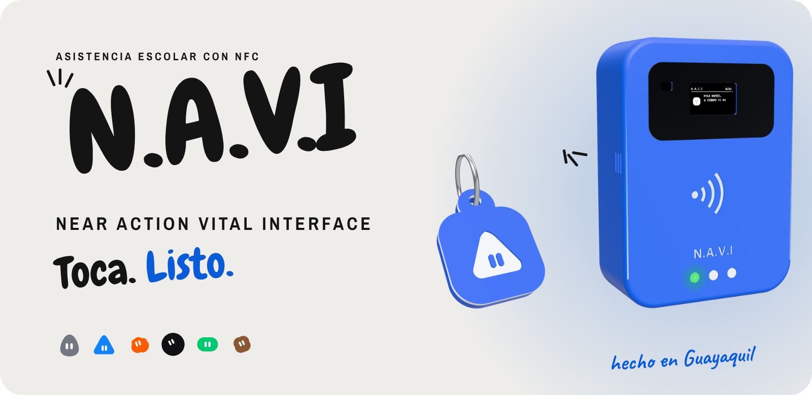
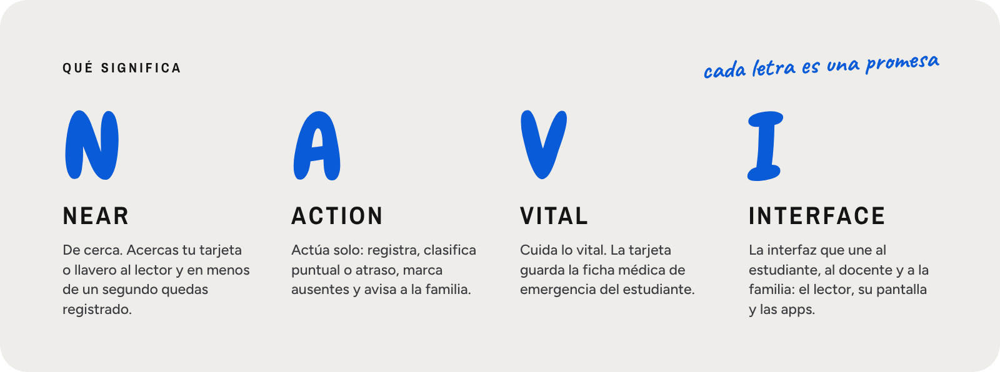
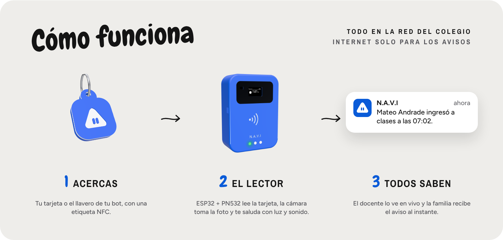
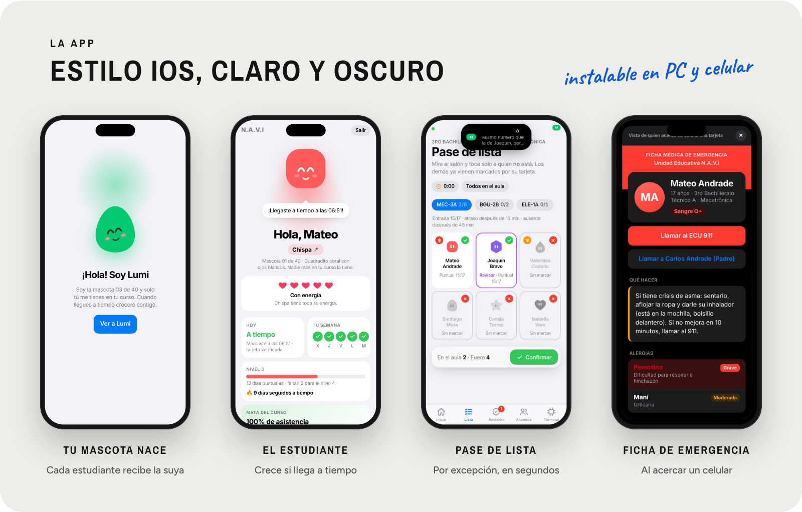
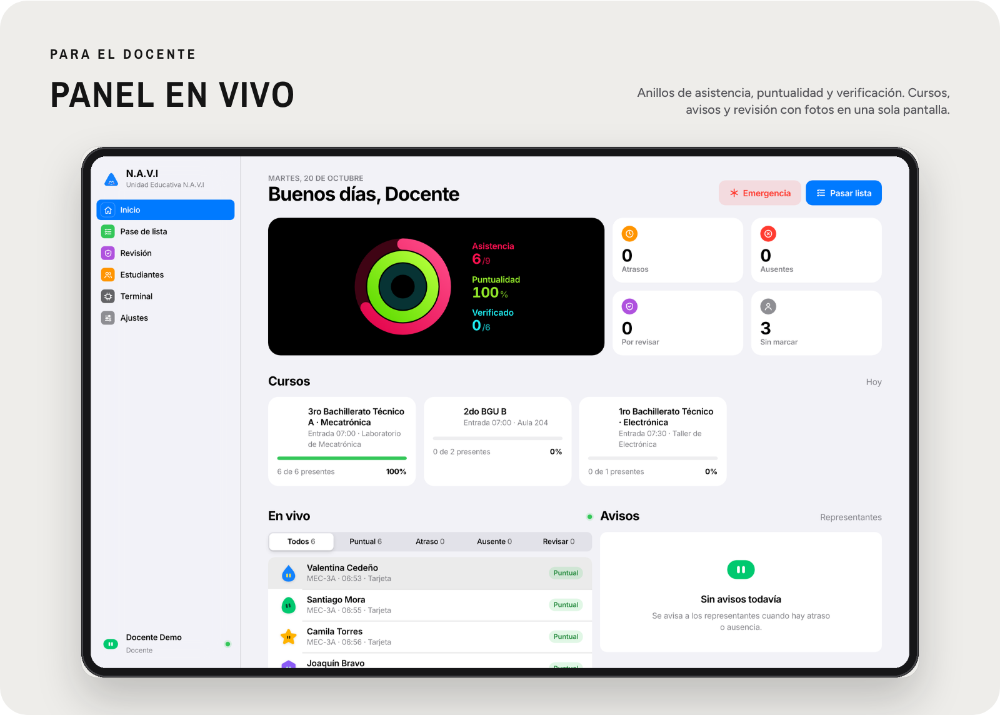
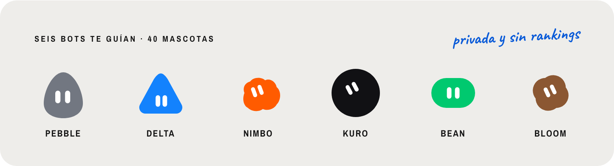
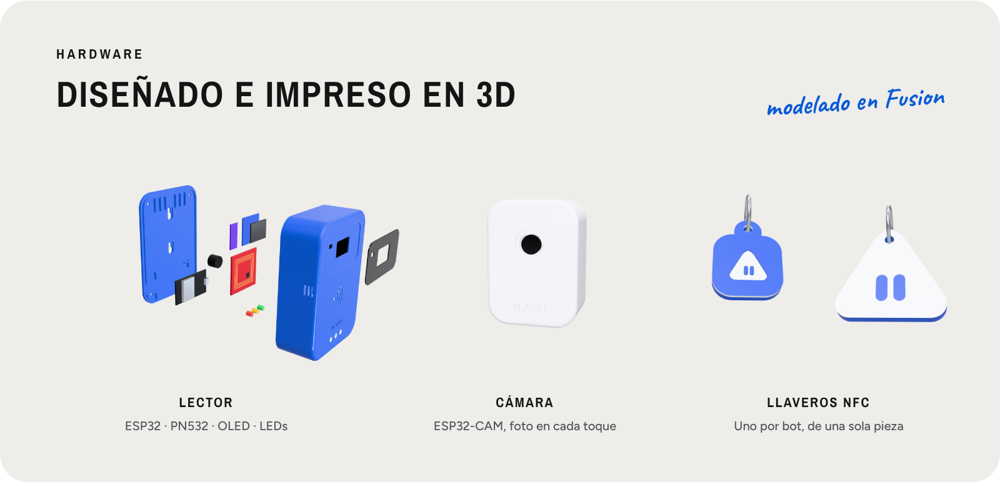
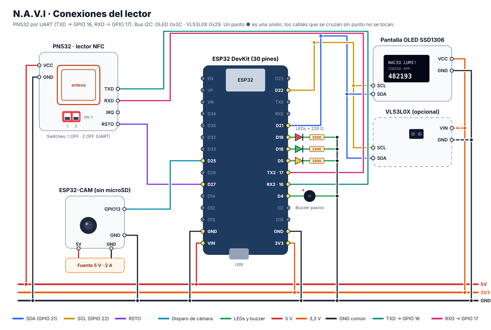

<p align="center">
  
</p>

<p align="center">
  
  
  
  
  
</p>

<h3 align="center">Asistencia escolar con tarjetas NFC</h3>

<p align="center">
  El estudiante acerca su tarjeta, el lector lo registra en menos de un segundo,<br>
  la familia recibe el aviso al instante y el docente solo confirma a quien no está.
</p>

<p align="center">
  <a href="#significado"><b>Significado</b></a> ·
  <a href="#como-funciona"><b>Cómo funciona</b></a> ·
  <a href="#app"><b>La app</b></a> ·
  <a href="#hardware"><b>Hardware</b></a> ·
  <a href="#probarlo-ya"><b>Probarlo ya</b></a> ·
  <a href="#documentación"><b>Documentación</b></a>
</p>

<br>

<a id="significado"></a>

<p align="center">
  
</p>

<a id="como-funciona"></a>

<p align="center">
  
</p>

Todo corre en la red del colegio: sin internet, en el WiFi del colegio o en el hotspot de un celular. El lector y la app encuentran el servidor solos, e internet solo se usa para enviar los avisos.

<a id="app"></a>

<p align="center">
  
</p>

<p align="center">
  
</p>

<p align="center">
  
</p>

Cada estudiante tiene su propia mascota, que crece cuando llega a tiempo y lo extraña cuando falta. Es privada y no hay rankings: la meta es de todo el curso. Cada cuenta nueva recibe un recorrido guiado por su bot.

## Nadie marca por otro

Ningún sistema barato impide al 100 % que un amigo pase la tarjeta de otro. N.A.V.I lo vuelve **detectable** y **arriesgado**:

1. **El docente confirma la lista por excepción.** Si una tarjeta marcó pero el alumno no está sentado, el registro pasa a revisión. Toma unos 20 segundos.
2. **Una presencia, una tarjeta.** Con el sensor VL53L0X opcional, dos tarjetas mientras la misma persona está frente al lector quedan marcadas. Sin el sensor, se marca a quien pasa dos tarjetas en menos de 1,5 s.
3. **Foto en cada toque.** Sin foto o con la cámara tapada, el registro queda para revisión.
4. **Patrones.** Si las mismas dos tarjetas se marcan juntas varios días, se avisa.

> [!NOTE]
> Los registros sospechosos **nunca** mandan alertas de "fraude" a los padres. El docente o inspector revisa y decide; solo si confirma la suplantación se avisa al representante que el estudiante no estaba en el aula.

## Qué hace cada parte

| Parte | Qué hace |
| --- | --- |
| **Lector** (ESP32 + PN532 + OLED) | Lee la tarjeta, avisa a la cámara y muestra el resultado en ~1 segundo. Si se cae el WiFi guarda los registros con su hora y los envía después. |
| **Cámara** (ESP32-CAM) | Toma una foto en el momento del toque. Si sale negra (cámara tapada) el registro queda para revisión. |
| **Servidor** (Node.js + SQLite) | Clasifica puntual o atraso, marca ausentes al pasar el límite, detecta señales raras y avisa a los representantes. |
| **Ficha médica de emergencia** | Alergias, condiciones, medicamentos y contactos. Quien acerque su celular a la tarjeta ve qué hacer; el colegio y el representante reciben un aviso. |
| **App web instalable** | Estilo iOS (claro y oscuro), panel en vivo con anillos, pase de lista por excepción, revisión con fotos, estudiantes, simulador del lector, reportes CSV y ajustes. |
| **App de Android** | NFC nativo y la demostración completa dentro del celular con el código **12122008**. |

<a id="hardware"></a>

<p align="center">
  
</p>

La carcasa del lector, la caja de la cámara, el soporte de mesa con ganchos y un llavero de una sola pieza para cada bot están en [`hardware/cad`](hardware/cad) (STEP y STL, listos para imprimir).

| | |
| --- | --- |
| Materiales y costos | [`docs/LISTA_DE_MATERIALES.md`](docs/LISTA_DE_MATERIALES.md) |
| Conexiones y esquemático | [`docs/CONEXIONES_Y_ESQUEMATICO.md`](docs/CONEXIONES_Y_ESQUEMATICO.md) |
| Carcasa, soporte y llaveros | [`docs/CARCASA_Y_LLAVEROS.md`](docs/CARCASA_Y_LLAVEROS.md) |
| Programar el ESP32 | [`PROBAR_CON_LOS_MODULOS.md`](PROBAR_CON_LOS_MODULOS.md) |

<details>
<summary><b>Ver el diagrama de conexiones</b></summary>
<br>
<p align="center"></p>
</details>

## Probarlo ya

1. Instala **Node.js LTS** si no lo tienes: https://nodejs.org/es
2. Elige cómo abrirlo:
   - **`INICIAR_NAVI.bat`**: el sistema real del colegio. Empieza vacío: la primera cuenta que crees es la del administrador. Tu bot te da un recorrido de un minuto y luego la app te guía con **Primeros pasos** (curso, estudiantes, lector y tarjetas).
   - **`INICIAR_NAVI_DEMO.bat`**: la demostración, con estudiantes de ejemplo, la cuenta demo y el simulador del lector. Usa su propia base de datos (`backend/data-demo`), así que nunca se mezcla con la real.
3. La primera vez instala lo necesario y abre el navegador en `http://localhost:3000`.

> [!TIP]
> ¿Sin instalar nada? Abre [`docs/NAVI_prueba_navegador.html`](docs/NAVI_prueba_navegador.html): es la demostración completa en un solo archivo. En la app de Android, escribe **12122008** en el campo del servidor y toca **Conectar**.

## Documentación

| Para | Lee |
| --- | --- |
| Conectar el lector real | [`PROBAR_CON_LOS_MODULOS.md`](PROBAR_CON_LOS_MODULOS.md) |
| Todo un colegio (un lector por aula) | [`docs/VARIOS_LECTORES_Y_CURSOS.md`](docs/VARIOS_LECTORES_Y_CURSOS.md) |
| Instalar la app en PC o celular | [`docs/INSTALAR_APP.md`](docs/INSTALAR_APP.md) |
| App de Android y mascotas | [`docs/APP_ANDROID_Y_MASCOTAS.md`](docs/APP_ANDROID_Y_MASCOTAS.md) |
| Ficha médica | [`docs/FICHA_MEDICA.md`](docs/FICHA_MEDICA.md) |
| Avisos por WhatsApp y correo | [`docs/CONFIGURACION_WHATSAPP_Y_EMAIL.md`](docs/CONFIGURACION_WHATSAPP_Y_EMAIL.md) |
| Informe técnico (KILLTRONIC 8.0) | [`docs/INFORME_TECNICO_NAVI.pdf`](docs/INFORME_TECNICO_NAVI.pdf) |
| Presentación | [`docs/NAVI_Presentacion.html`](docs/NAVI_Presentacion.html) |
| Guía de exposición | [`docs/GUIA_DE_COMPETENCIA_PITCH.md`](docs/GUIA_DE_COMPETENCIA_PITCH.md) |

<details>
<summary><b>Estructura del proyecto</b></summary>

```
proyecto con pn532/
├── INICIAR_NAVI.bat            Sistema real: inicia el servidor y abre la app
├── INICIAR_NAVI_DEMO.bat       Demostración con datos de ejemplo (base de datos aparte)
├── PROBAR_CON_LOS_MODULOS.md   Guía para conectar y programar el ESP32
├── COMPARTIR_EN_CELULAR.bat    Enlace HTTPS temporal para instalar la app en el celular
├── backend/                    Servidor (Node.js 22.13 o más nuevo, sin nada que compilar)
│   ├── server.js               API REST + WebSocket
│   ├── attendance.js           Asistencia, ausencias, revisión y cámara
│   ├── pet.js / student.js     Mascotas, corazones y cuenta del estudiante
│   ├── credential.js           Credencial firmada que se graba en la tarjeta
│   ├── notifier.js             Correo, SMS, Telegram y enlaces de WhatsApp
│   ├── database.js / sqlite.js Esquema y base de datos SQLite integrada en Node
│   ├── data/ y data-demo/      Datos reales y de la demostración (se crean solos)
│   └── public/                 App web instalable (PWA)
├── android/                    App de Android (NFC nativo, demostración con el código 12122008)
├── firmware/                   Lector ESP32 + PN532 y cámara ESP32-CAM
├── hardware/cad/               Carcasa, caja de la cámara, soporte y llaveros (STEP y STL)
├── tools/                      Scripts para generar el APK, la demostración y el video
└── docs/                       Guías, informe técnico, presentación y demostración en un solo archivo
```

</details>

## Privacidad

- La base de datos está en `backend/data/navi.sqlite`. Ni ella, ni las fotos, ni `mis_datos.h` (tu WiFi) ni `servidor.h` (la clave de terminal) se suben a GitHub.
- La clave de terminal se genera sola y aparece en la ventana del servidor y en **Lector → Configuración del firmware** (solo para el administrador).
- N.A.V.I no usa datos biométricos.

<br>

<p align="center">
  <b>Daniel Heredia · Noelya Arreaga</b><br>
  Bachillerato Técnico en Mecatrónica · Colegio Fiscomisional Salesiano Domingo Comín<br>
  Docente tutor: Alejandro Sánchez<br>
  <sub>KILLTRONIC 8.0 · Impacto Tecnológico · Hecho en Guayaquil, Ecuador</sub>
</p>
