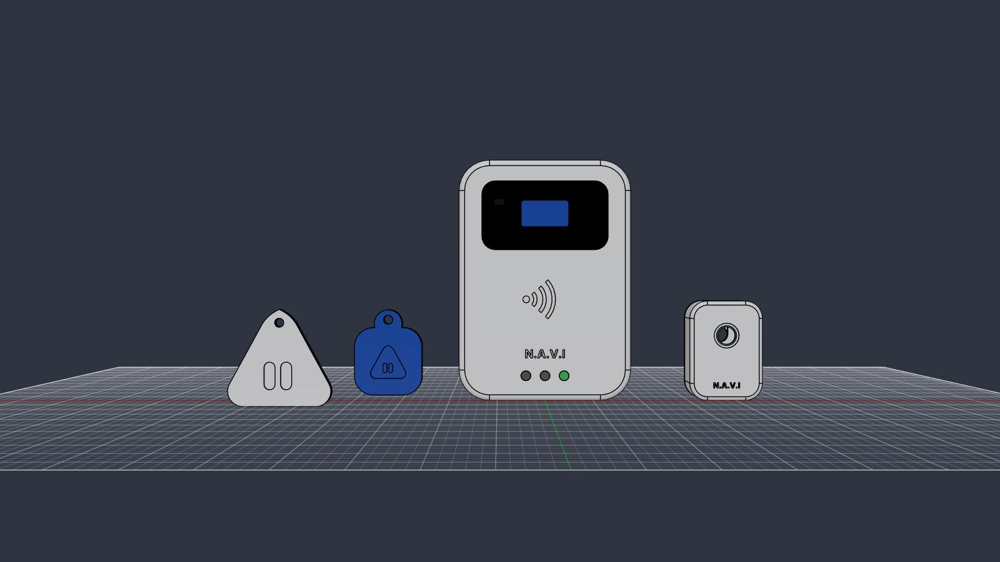
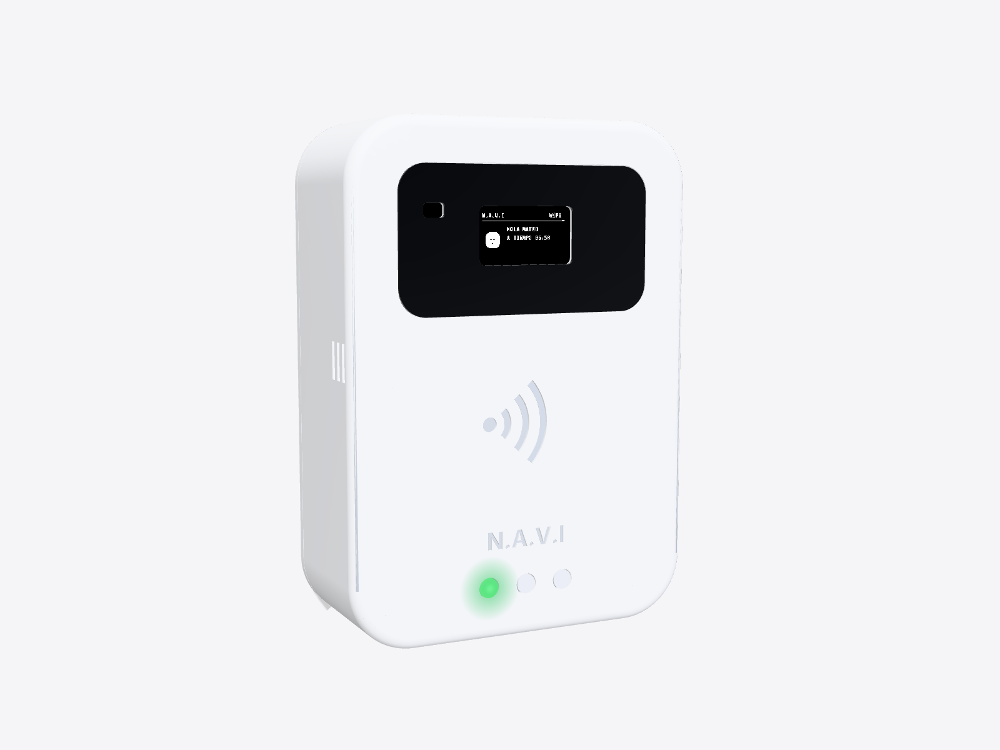
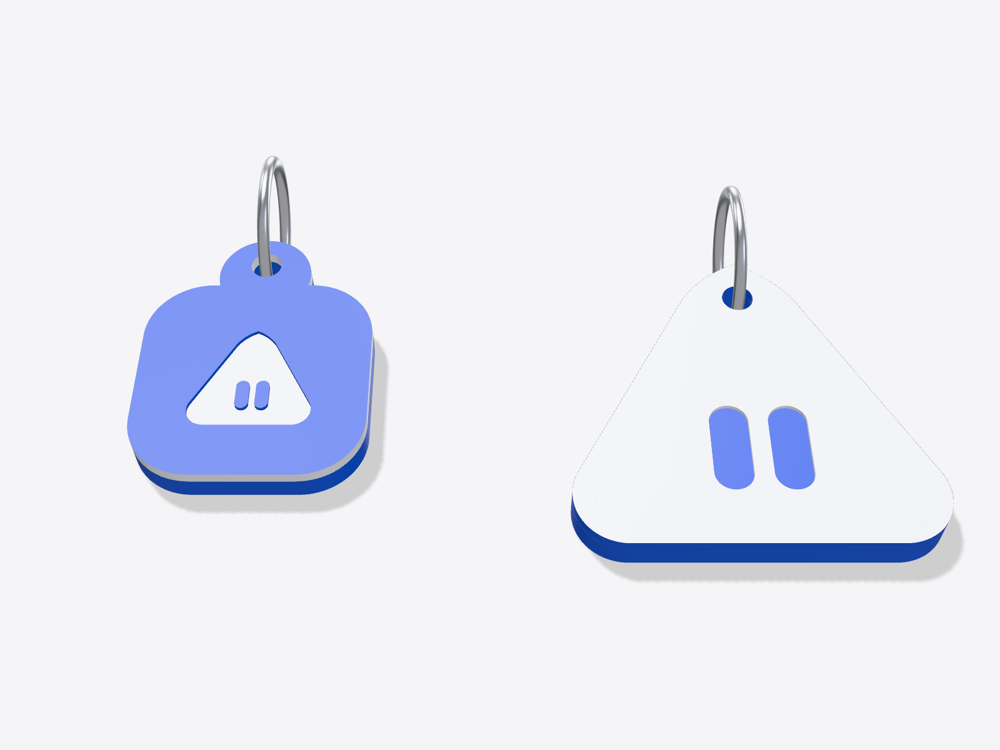

# Carcasa del lector y llaveros NFC

Todo está en `hardware/cad/`. Cada pieza viene en dos formatos:

- `.step`: ábrelo en Fusion (Archivo → Abrir → *Abrir desde mi equipo*). Se abre como un cuerpo sólido que puedes medir, cortar y modificar con *Presionar/Tirar*, *Combinar*, etc.
- `.stl`: listo para el programa de impresión (Cura, PrusaSlicer, Bambu Studio).

El modelo se generó con código (`navi_cad.py`, con CadQuery). Si cambias una medida en ese archivo y lo ejecutas, se vuelven a crear todas las piezas.

En tu Fusion ya está armado el ensamble **"NAVI - Lector, camara y llaveros"** (Default Project): el lector cerrado con su panel negro, la caja de la cámara y los dos llaveros, con colores. Incluye un componente **"Modulos (referencia)"** con bloques del tamaño del PN532, la OLED, el VL53L0X, el ESP32, el buzzer y los LEDs. El análisis de interferencias de Fusion no encontró choques entre las piezas impresas ni con los módulos.





## 1. Lector (igual al del video)

Medidas externas: **90 × 126 × 40 mm**.

| Pieza | Archivo | Color | Cómo imprimirla |
| --- | --- | --- | --- |
| Frente | `lector_frente` | Blanco | Con la cara frontal sobre la cama, sin soportes |
| Tapa trasera | `lector_tapa` | Blanco | Con la cara exterior sobre la cama, sin soportes |
| Panel de la pantalla | `lector_panel_negro` | Negro | Plano sobre la cama (0,8 mm) |

Ajustes sugeridos: PLA, capa de 0,2 mm, 3 perímetros, 20 % de relleno. El frente tiene solo 1,6 mm de pared delante del PN532 para que lea bien la tarjeta o el llavero.

### Dónde va cada componente (visto de frente)

| Componente | Posición | Cómo se sujeta |
| --- | --- | --- |
| OLED 0,96" (27,3 × 27,8 mm) | Detrás del panel negro, arriba | 4 esquineros + cinta doble faz |
| VL53L0X GY-530 (25 × 10,7 mm, opcional) | A la izquierda de la pantalla, ventana de 6 × 4 mm en el panel | 4 esquineros + cinta |
| PN532 V3 (43 × 41 × 4 mm), switches en I2C | Centro, detrás del símbolo NFC, pegado al frente | 4 esquineros + cinta doble faz |
| 3 LEDs de 5 mm | Abajo: verde a la izquierda, amarillo al centro, rojo a la derecha | Entran a presión en sus tubos |
| Buzzer de 12 mm | Arriba a la izquierda por dentro; el sonido sale por las ranuras del lado izquierdo | Vaso a presión |
| ESP32 DevKit V1 de 30 pines (52 × 28 mm) | En la tapa trasera, abajo, con el USB hacia el lado derecho | 4 esquineros + cinta |
| Cable USB de 5 V | Sale por la muesca del lado derecho | — |

**Tornillería:** 4 tornillos M3 × 10 mm (los postes tienen agujero de 2,6 mm para autorroscar, o pon insertos térmicos M3). Para la pared: 2 tornillos con cabeza de 7 a 8 mm en las ranuras tipo bocallave, separadas 40 mm.

**Cables:** el espacio interior es justo. Usa cables soldados o conectores Dupont con los pines doblados a 90°, sobre todo en el PN532 y el ESP32.

### Pasos de armado

1. Pega el panel negro en su hueco del frente.
2. Coloca el OLED, el PN532 (con switch 1 en ON y switch 2 en OFF) y, si lo usas, el VL53L0X en sus esquineros. Ponlos con la cara hacia el frente.
3. Mete los LEDs desde adentro. La pata larga (+) va al GPIO y la corta a GND con su resistencia de 220 Ω.
4. Encaja el buzzer en su vaso.
5. Pega el ESP32 en la tapa con el USB hacia la muesca.
6. Conecta todo según `CONEXIONES_Y_ESQUEMATICO.md`, prueba que funcione y recién entonces cierra con los 4 tornillos.

## 2. Cámara (módulo aparte)

El ESP32-CAM no entra en el lector sin tapar la pantalla, y necesita su propia fuente de 5 V y 2 A. Por eso tiene su propia cajita:

| Pieza | Archivo |
| --- | --- |
| Frente con agujero para el lente | `camara_frente` |
| Tapa con bocallave para la pared | `camara_tapa` |

- **Medidas:** 38 × 52 × 25 mm.
- **Montaje:** va en la pared, justo encima del lector.
- **Cables:** por el agujero inferior pasan los 2 cables al lector (GPIO 25 → GPIO 13 y GND común) y el de alimentación.

## 3. Llaveros NFC personalizados (dos partes)



Hay dos modelos. Los dos llevan adentro una **etiqueta NFC NTAG213 redonda de 25 mm**, de las que vienen en stickers.

| Modelo | Base (con nombre atrás) | Tapa (con el logo) | Medidas |
| --- | --- | --- | --- |
| Icono de la app | `llavero_icono_base_mateo` | `llavero_icono_tapa` | 34 × 43 × 5,4 mm |
| Bot triángulo | `llavero_bot_base_mateo` | `llavero_bot_tapa` | 52 × 49 × 5,4 mm |

### Logo a dos colores sin impresora multicolor

La tapa se imprime **con la cara del logo sobre la cama** y una **pausa a 0,6 mm** para cambiar el filamento:

- **Icono:** empieza en azul. En la pausa cambia a blanco. Queda azul con el triángulo blanco y los ojos azules, igual al ícono de la app.
- **Bot:** empieza en blanco. En la pausa cambia a azul. Queda el triángulo blanco con los ojos azules.

En Cura: *Extensiones → Postprocesado → Pausa a una altura de 0,6 mm*. En PrusaSlicer o Bambu Studio: clic derecho sobre la capa 0,6 mm en la vista previa → *Agregar pausa* o *Cambio de filamento*.

La base se imprime en azul con la parte de atrás sobre la cama. Así el nombre queda grabado y se lee bien.

### Armado del llavero

1. Pega la etiqueta NFC en el hueco redondo de la base.
2. Presiona la tapa: el borde interior encaja en la base. Una gota de pegamento la deja permanente.
3. Pon la argolla.
4. En la app: **Estudiantes → (estudiante) → Tarjeta y acceso → Tarjeta nueva con el lector** y acerca el llavero al lector. Queda asignado y grabado con su credencial firmada.

No uses argolla gruesa de metal pegada a la etiqueta: el metal muy cerca de la antena reduce la distancia de lectura.

### Un llavero con otro nombre

```
python navi_cad.py nombre "SOFIA" "MEC-3A"
```

Crea `llavero_icono_base_sofia` y `llavero_bot_base_sofia`. La tapa es la misma para todos.

## Medidas usadas y comprobación

| Módulo | Medida del modelo | Fuente |
| --- | --- | --- |
| PN532 V3 | 43 × 41 × 4 mm (el fabricante indica 42,7 × 40,4 y 43 × 41) | [Manual Elechouse V3](https://www.elechouse.com/elechouse/images/product/PN532_module_V3/PN532_%20Manual_V3.pdf) |
| ESP32 DevKit V1 (30 pines) | 52 × 28,3 mm | [SpeakCAD](https://speakcad.com/blog/esp32-enclosure-3d-print) |
| OLED 0,96" SSD1306 (4 pines) | 27,3 × 27,8 mm; ventana de 25 × 15 mm, más grande que el área activa (unos 22 × 11 mm) | Medida común del módulo |
| VL53L0X GY-530 | 25 × 10,7 mm; el sensor ve en un cono de 25° | [Electropeak](https://electropeak.com/gy-530-vl53l0x-laser-ranging-sensor-module-double-hole), [hoja de datos ST](https://www.pololu.com/file/0J1187/vl53l0x.pdf) |
| ESP32-CAM | 27 × 40,5 × 4,5 mm | [DFRobot](https://wiki.dfrobot.com/dfr0602/) |
| Buzzer pasivo | Ø 12 × 9,5 mm | Medida común |
| Etiqueta NTAG213 | Ø 25 mm | Medida común del sticker |

Cada esquinero deja entre 0,35 y 0,5 mm de holgura por lado.

En Fusion se pusieron bloques de esas medidas dentro de las carcasas. El análisis de interferencias dio **0 choques**: los módulos entran y no tocan los postes, las paredes ni la tapa. La OLED va con los pines hacia arriba.

## Antes de imprimir el lote

- Las medidas de los módulos son las más comunes, pero cambian según el fabricante. Mide los tuyos con un calibrador y compáralos con la tabla de arriba. Las medidas están al inicio de `navi_cad.py`.
- Imprime primero solo el frente del lector o un llavero y prueba que encajen.
- Las piezas no se han impreso todavía. Si algo queda justo o flojo, dime cuánto (por ejemplo, "el PN532 no entra por 0,5 mm") y lo ajusto.
