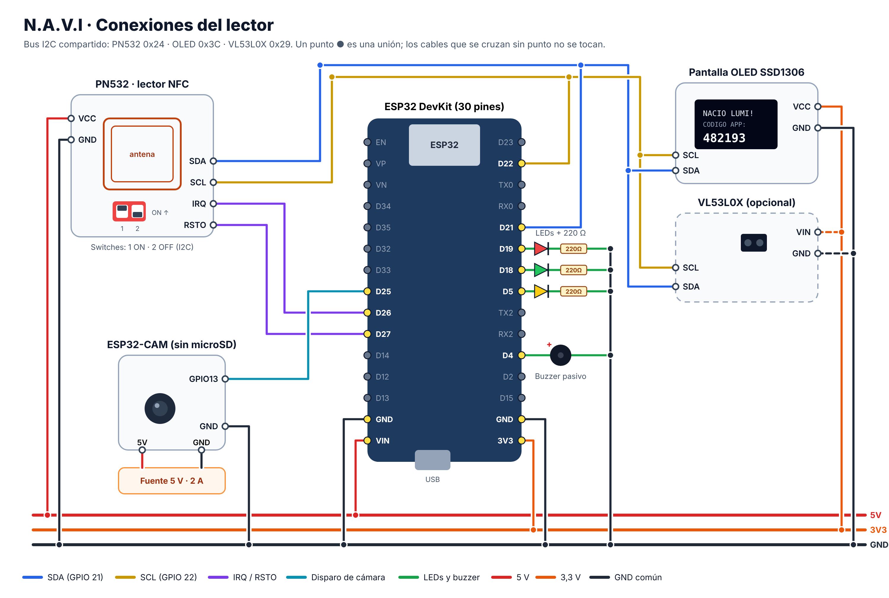

# Conexiones del terminal N.A.V.I

Todos los pines están en `firmware/navi_esp32_pn532/config.h` por si necesitas cambiarlos.

Versión vectorial para imprimir: `conexiones.svg`.

**Antes de conectar:** arma todo con el ESP32 desconectado del USB, revisa dos veces 5V, 3.3V y GND, y conecta el USB al final.

## 1. Switches del PN532 (modo I2C)

| Switch | Posición |
| :---: | :---: |
| 1 | **ON** (arriba, hacia la palabra ON) |
| 2 | **OFF** |

Así queda en modo I2C. Con 1 OFF y 2 ON queda en SPI, y con los dos en OFF queda en UART: en esos modos el ESP32 no lo encuentra. Cambia los switches con el módulo apagado.

## 2. Lector: ESP32 + PN532 + OLED + LEDs + buzzer

| Componente | Pin del componente | Pin del ESP32 | Notas |
| --- | --- | --- | --- |
| PN532 | VCC | 5V (VIN) | |
| PN532 | GND | GND | |
| PN532 | SDA | GPIO 21 | Bus I2C compartido |
| PN532 | SCL | GPIO 22 | Bus I2C compartido |
| PN532 | IRQ | GPIO 26 | Recomendado |
| PN532 | RSTO | GPIO 27 | Recomendado |
| OLED SSD1306 | VCC | 3.3V | |
| OLED SSD1306 | GND | GND | |
| OLED SSD1306 | SDA | GPIO 21 | |
| OLED SSD1306 | SCL | GPIO 22 | |
| LED verde (puntual) | ánodo (+) | GPIO 18 | Resistencia 220 Ω a GND |
| LED amarillo (atraso, revisión, sin red) | ánodo (+) | GPIO 5 | Resistencia 220 Ω a GND |
| LED rojo (tarjeta no registrada, error) | ánodo (+) | GPIO 19 | Resistencia 220 Ω a GND |
| Buzzer pasivo | + | GPIO 4 | – a GND |
| Disparo de cámara | cable | GPIO 25 | Va al GPIO 13 del ESP32-CAM |

Notas del PN532:

- El bus I2C (SDA y SCL) lo comparten el PN532, la OLED y el VL53L0X: los tres van a los mismos GPIO 21 y 22.
- Si después de cambiar los switches el lector no aparece, desconecta y vuelve a conectar la alimentación: el PN532 solo lee los switches al encender.
- Con el ESP32 encendido y sin tarjeta, mide con un multímetro entre SDA y GND: debe marcar unos 3,3 V. Si marca 5 V, pasa el VCC del PN532 al pin 3V3 del ESP32 para no forzar sus entradas (lee un poco menos lejos, pero funciona igual).
- La antena del PN532 es la zona del recuadro impreso. No pongas metal ni cables por delante; la tarjeta se lee hasta unos 3 a 5 cm.
- Si el PN532 está lejos del ESP32, usa cables de menos de 20 cm para el I2C.

### Plan B: PN532 por UART

Si el Monitor serie dice `PN532 no detectado` aunque los switches y los cables estén bien, conéctalo por UART. Con el ESP32 suele ser más estable y deja el bus I2C solo para la pantalla.

| Paso | Qué hacer |
| --- | --- |
| Switches | **1 en OFF y 2 en OFF** |
| Pin SDA/TXD del PN532 | **GPIO 16** (RX2) |
| Pin SCL/RXD del PN532 | **GPIO 17** (TX2) |
| VCC y GND | Igual que antes |
| `config.h` | Cambia `#define PN532_UART 0` a `#define PN532_UART 1` y vuelve a subir el programa |

La pantalla OLED sigue en GPIO 21 y 22.

## 3. Cámara: ESP32-CAM

| Desde | Hacia | Notas |
| --- | --- | --- |
| GPIO 25 del lector | GPIO 13 del ESP32-CAM | Pulso de disparo en el momento del toque |
| GND del lector | GND del ESP32-CAM | **Obligatorio**: sin tierra común el disparo no funciona |
| Fuente 5 V 2 A | 5V y GND del ESP32-CAM | Fuente propia y estable |

No uses tarjeta microSD en el ESP32-CAM: el GPIO 13 también es un pin de la SD.

## 4. Sensor de presencia VL53L0X (opcional)

| VL53L0X | ESP32 |
| --- | --- |
| VIN | 3.3V |
| GND | GND |
| SDA | GPIO 21 |
| SCL | GPIO 22 |

Después pon `#define USE_PRESENCE_SENSOR 1` en `config.h`. Ajusta `PRESENCE_MM` (650 mm por defecto) a la distancia a la que se para la persona frente al lector.

## 5. Grabar las tarjetas con el PN532 (sin celular)

El mismo lector graba las tarjetas, así ningún estudiante ni docente necesita un celular con NFC.

**Tarjetas recomendadas:** NTAG213 (144 bytes) o NTAG215. Las MIFARE Classic que vienen con algunos kits sirven para marcar asistencia, pero no guardan la credencial: el lector muestra `USE TARJETA · NTAG213 O NTAG215`.

**Tarjeta de un estudiante ya registrado:**

1. En la app: **Estudiantes → (estudiante) → Tarjeta y acceso → Grabar con el lector del aula**.
2. La app muestra una cuenta regresiva de 90 segundos.
3. El estudiante deja su tarjeta **quieta** sobre el lector hasta oír dos bips. La pantalla dice `GRABANDO`, luego `GRABADA · TARJETA LISTA`.
4. El lector vuelve a leer lo que grabó y lo compara antes de avisar al servidor. En la app aparece "Tarjeta grabada".

**Tarjeta nueva o de reemplazo:** usa **Tarjeta nueva con el lector**. La próxima tarjeta que no sea de otro estudiante queda asignada a ese estudiante y se graba en el mismo toque. La tarjeta anterior deja de servir.

Mientras la grabación espera, los demás estudiantes pueden seguir marcando con normalidad.

Qué se graba en la tarjeta: un enlace a la ficha de emergencia (si el representante lo autorizó) y la credencial firmada `NAVI1.código.versión.firma`. La firma la calcula el servidor con una clave que nunca sale de él.

| Pantalla | Qué hacer |
| --- | --- |
| `NO GRABO · SE MOVIO` | La tarjeta se movió. Vuelve a acercarla y déjala quieta. |
| `NO GRABO · VERIFICACION` | Se grabó, pero al releer no coincidió. Vuelve a acercarla; si se repite, cambia la tarjeta. |
| `NO GRABO · MUY GRANDE` | El enlace del servidor es muy largo para la tarjeta. Usa la IP del servidor, no un nombre largo. |
| `USE TARJETA · NTAG213 O NTAG215` | La tarjeta no es NTAG. Cámbiala. |

## 6. Primera vez en el lector: nace la mascota y se crea la cuenta

1. La primera vez que un estudiante marca asistencia, la pantalla muestra **su mascota** (32×32 píxeles) y `NACIO LUMI! · CODIGO APP: 482193`.
2. En cualquier celular (con o sin NFC, Android o iPhone) abre la app, elige **Estudiante → Usar el lector del aula** y escribe el código de 6 números. Sirve una sola vez y vence en 12 horas, así puede crear la cuenta en el recreo o en casa.
3. Crea un PIN de 4 números. Desde ese momento la cuenta queda guardada en la base de datos y **el lector ya no vuelve a mostrar códigos**: cada día solo saluda (`HOLA MATEO · A TIEMPO`) con su mascota.
4. La sesión del celular dura todo el año lectivo y se renueva sola cada vez que abre la app.
5. Si cambia de celular u olvida el PIN, el docente toca **Restablecer PIN y celulares**: el siguiente toque en el lector vuelve a mostrar un código, una sola vez.

Mientras el estudiante no crea su cuenta, cada toque muestra un código nuevo y el anterior deja de servir.

La cuenta del estudiante es distinta a la del docente: no usa correo ni contraseña, solo ve su asistencia, su mascota y su ficha, y no puede ver a otros estudiantes ni cambiar nada del curso.

### La vida de la mascota en el lector

| Pantalla | Cuándo |
| --- | --- |
| Mascota feliz + `HOLA MATEO · A TIEMPO` | Llegó a tiempo |
| Mascota + `HOLA MATEO · ME SALVASTE!` | Volvió después de 2 o más faltas seguidas: recupera todos los corazones |
| `HOLA MATEO · ELIGE MASCOTA` (sin dibujo) | Su mascota se fue por 5 faltas seguidas sin justificar; debe elegir un huevo nuevo en la app |
| `NACIO BOLT! · CODIGO APP` | Su mascota se fue y aún no tenía cuenta: recibe un huevo nuevo automáticamente |

## 7. Direcciones I2C esperadas

Si cargas el ejemplo *I2C Scanner* deberías ver:

- `0x24`: PN532
- `0x3C`: OLED
- `0x29`: VL53L0X (si lo conectaste)

## 8. Configurar y subir el firmware

1. Arranca el servidor con `INICIAR_NAVI.bat`. Al iniciar, el servidor escribe `servidor.h` en las dos carpetas del firmware con la IP de tu PC, el puerto y la clave de terminal. `config.h` lo usa solo.
2. En **ambas** carpetas abre `config.h` y escribe solo `WIFI_SSID` y `WIFI_PASS`. Deja el mismo `TERMINAL_ID` en el lector y en la cámara: así el servidor sabe que van juntos.
3. En Arduino IDE instala las librerías **Adafruit PN532**, **Adafruit SSD1306**, **Adafruit GFX** y **ArduinoJson** (y **Adafruit VL53L0X** si usas el sensor).
4. Sube `navi_esp32_pn532.ino` al ESP32 (placa *ESP32 Dev Module*) y `navi_esp32_cam.ino` al ESP32-CAM (placa *AI Thinker ESP32-CAM*).
5. En **Lector → Hardware conectado** deben aparecer el lector y la cámara como "En línea".

Si la IP de la PC cambia, vuelve a abrir `INICIAR_NAVI.bat` y vuelve a subir el programa. La guía paso a paso está en [`PROBAR_CON_LOS_MODULOS.md`](../PROBAR_CON_LOS_MODULOS.md).

## 9. Qué significa cada señal del lector

| LED y sonido | Pantalla | Significado |
| --- | --- | --- |
| Verde, bip agudo | HOLA MATEO · A TIEMPO | Registrado puntual |
| Amarillo, bip medio | HOLA MATEO · ATRASO | Registrado con atraso |
| Amarillo | REGISTRO EN REVISION | Registrado, pero el docente debe revisarlo |
| Amarillo | YA MARCO 07:02 | Ya había marcado hoy (si aún no tiene cuenta, también muestra su código) |
| Verde | Mascota + NACIO LUMI! + código | Primer registro del estudiante: nació su mascota |
| Verde o amarillo | Mascota + ME SALVASTE! | Volvió después de varias faltas seguidas |
| Verde o amarillo | ELIGE MASCOTA | Su mascota se fue; elige otra en la app |
| Verde, dos bips | GRABADA · TARJETA LISTA | La tarjeta se grabó y se comprobó |
| Rojo | NO GRABO | No se pudo grabar (ver sección 5) |
| Amarillo | GUARDADO · SIN RED | Sin WiFi: se guardó y se enviará solo |
| Rojo, tono grave | TARJETA NO REGISTRADA | Tarjeta desconocida (aparece en la app para registrarla) |
| Rojo | CLAVE INCORRECTA | `TERMINAL_KEY` no coincide con el servidor |
